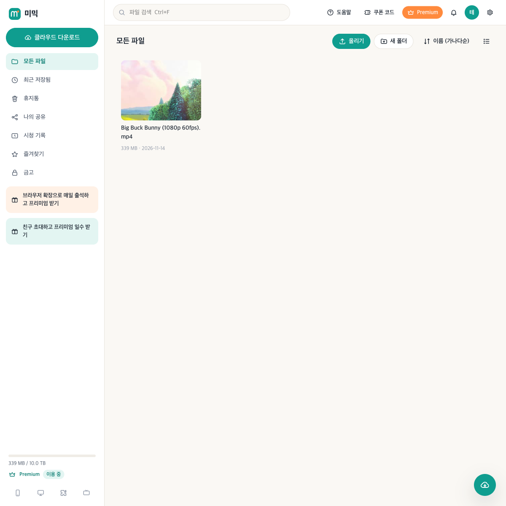
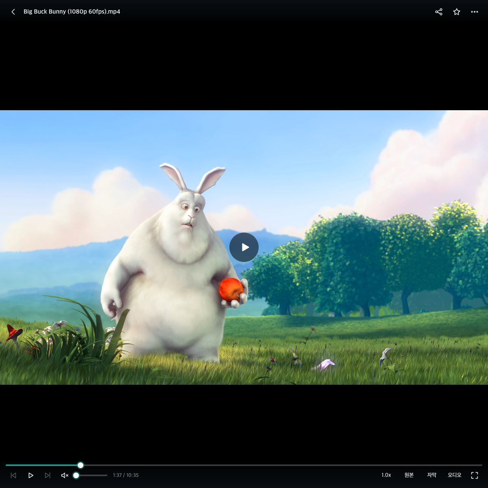

# 공유 라이브러리 설계 (초안 v0.1 · 2026-11-14)

> 상태: **설계 초안 — 구현 전.** 7장의 `결정 필요` 항목은 프로젝트 책임자가 정한다(임의로 정하지 않음).
> 범위: 1단계(기능·주소 설계). 본 서버·오브젝트 스토리지·CDN 선정은 2단계(출시 전)로 미룬다.

## 1. 한 줄 요약

운영자가 **원본 공간(라이브러리, 예: 1TB)** 에 영상을 한 번만 올리고, 유저는 **개별 링크**를 받아 그 영상을 **자기 계정 공간에 "담아"** 스트리밍으로 본다. 유저가 몇 명이 담아도 디스크에는 원본 1벌뿐이라 **저장 공간은 라이브러리 크기를 넘지 않는다.**

기존 PikPak식 기능(클라우드 다운로드·업로드·공유 등)은 그대로 두고, 그 위에 **`library` 모듈을 하나 더한다.**

## 2. 지금 코드에서 이미 되는 것 (재사용)

| 이미 있는 것 | 위치 | 라이브러리에서 쓰는 방법 |
| --- | --- | --- |
| 파일 본문을 SHA-256 지문으로 **1벌만** 저장, `files` 는 지문을 가리키는 목록 | `server/core/storage.js`, `schema.sql`(`blobs`·`files.blob_hash`) | 담기 = 본문 복사 없이 `files` 줄 하나 추가 |
| 영상 변환본·썸네일·자막 캐시를 **지문 기준**으로 저장(`<MIMIC_DATA>/media/<hash>/`) | `server/modules/media/index.js` `mediaDir(hash)` | 1,000명이 담아도 720p 변환은 영상당 1번 |
| HLS 조각 변환(6초 조각) | `media/ff.js` `transcodeArgs(..., hls)` | CDN 이 보관하기 좋은 정적 조각 |
| 로그인 없이 쓰는 **서명된 임시 주소**(HMAC, 외부 플레이어용 C-03) | `media/index.js` `sign()`·`readExtToken()` | 같은 방식으로 재생 주소 서명 |
| 공유 저장·업데이트 동기화(D-04·D-05) | `server/modules/share/index.js` | 흐름·화면 참고(라이브러리는 "복사"가 아니라 "연결") |
| 유저별 전송 쿼터 | `server/core/quota.js`, `media` `transferOpts` | 시청 전송량 제한(7장 D-6) |

## 3. 용어

| 용어 | 뜻 |
| --- | --- |
| **라이브러리** | 운영자가 관리하는 원본 영상 공간. 전체 크기 상한(예: 1TB)이 있다 |
| **라이브러리 항목** | 라이브러리의 영상 1개(원본 지문 + 제목·설명·포스터 등) |
| **담기 링크** | 특정 항목(또는 항목 묶음)을 담을 수 있게 해 주는 개별 링크 `/l/<토큰>` |
| **담은 영상** | 유저 드라이브에 생긴 `files` 줄(`origin='library'`). 본문은 원본을 가리킬 뿐 |

## 4. 사용자 흐름

```
[운영자]  관리자 > 라이브러리 > 영상 올리기 ──→ 업로드 즉시 720p·원본 HLS 미리 변환(백그라운드)
             └─ 담기 링크 발급(받을 사람 1명용 / 여러 명용, 만료일, 최대 인원)
                                    │ 링크 전달(메신저·메일 등)
[유저]    /l/<토큰> 열기 → (로그인/가입) → 미리보기(포스터·제목·길이) → [내 공간에 담기]
             └─ 내 드라이브 "라이브러리" 폴더에 영상이 생김 → 기존 플레이어로 재생
                (이름 바꾸기·폴더 이동·즐겨찾기·이어보기·시청 기록은 각자 따로)
[운영자]  원본 교체(고화질로) → 담은 모든 유저에게 바로 반영
          원본 내림 → 담은 유저 화면에서 "더 이상 볼 수 없는 영상"으로 표시
```

## 5. 데이터 설계

### 5-1. 새 테이블 (`library` 모듈 `migrations`)

```sql
CREATE TABLE IF NOT EXISTS library_items (
  id TEXT PRIMARY KEY,                 -- li_xxx
  blob_hash TEXT NOT NULL REFERENCES blobs(hash),
  title TEXT NOT NULL,
  description TEXT NOT NULL DEFAULT '',
  size INTEGER NOT NULL,
  mime TEXT,
  duration REAL,
  status TEXT NOT NULL DEFAULT 'active',   -- active | hidden(새로 담기 중지) | removed(시청 중지)
  created_by TEXT REFERENCES users(id) ON DELETE SET NULL,
  created_at INTEGER NOT NULL,
  updated_at INTEGER NOT NULL
);

CREATE TABLE IF NOT EXISTS library_links (
  id TEXT PRIMARY KEY,                 -- ll_xxx
  token_hash TEXT NOT NULL UNIQUE,     -- 토큰 원문은 저장하지 않음(규칙 7)
  item_ids TEXT NOT NULL,              -- JSON 배열(1개 또는 묶음)
  max_claims INTEGER,                  -- NULL = 제한 없음, 1 = 1인용
  claims INTEGER NOT NULL DEFAULT 0,
  expires_at INTEGER,                  -- NULL = 영구
  note TEXT NOT NULL DEFAULT '',       -- 운영자 메모(누구에게 줬는지)
  created_by TEXT REFERENCES users(id) ON DELETE SET NULL,
  revoked_at INTEGER,
  created_at INTEGER NOT NULL
);

CREATE TABLE IF NOT EXISTS library_claims (
  user_id TEXT NOT NULL REFERENCES users(id) ON DELETE CASCADE,
  item_id TEXT NOT NULL REFERENCES library_items(id) ON DELETE CASCADE,
  link_id TEXT REFERENCES library_links(id) ON DELETE SET NULL,
  file_id TEXT,                        -- 유저 드라이브에 만든 files.id
  created_at INTEGER NOT NULL,
  PRIMARY KEY (user_id, item_id)       -- 같은 영상을 두 번 담지 않음
);
```

### 5-2. 담은 영상 = `files` 줄 하나

- `files` 에 `origin='library'`, `blob_hash = 항목의 지문`, `meta = {"libraryItemId": "li_xxx"}` 로 넣는다.
- 그래서 **드라이브 목록·플레이어·이어보기·시청 기록·즐겨찾기를 고치지 않고 그대로 쓴다.**
- 원본 교체: `UPDATE files SET blob_hash=?, size=? WHERE origin='library' AND json_extract(meta,'$.libraryItemId')=?` 한 번으로 모두 반영.
- 원본 내림(`removed`): 재생·다운로드 API 가 항목 상태를 확인해 410 을 돌려주고, 드라이브에는 "볼 수 없는 영상" 표시.

> 대안(채택 안 함): `files` 를 쓰지 않고 별도 "보관함" 화면만 두는 방식. 코어 변경은 없지만 드라이브·플레이어·시청 기록을 다시 만들어야 해서 일이 2~3배.

### 5-3. 코어 변경 요청 (`server/core/*` — BUILD_SPEC 0-3 에 따라 별도 승인 후 반영)

| 파일 | 변경 | 이유 |
| --- | --- | --- |
| `files.js` `usage()` | `origin='library'` 를 용량 계산에서 뺄지 결정(7장 D-1)에 따라 조건 추가 | 담은 영상이 개인 용량을 차지하지 않게 |
| `storage.js` `gcBlobs()` | `library_items.blob_hash` 도 참조로 인정 | 아무도 안 담은 라이브러리 원본이 1시간 뒤 지워지지 않게 |
| `web/app.js` `ROUTES` | `['/l/:token', 'library-claim', 'site', 'public']` 추가 | 담기 링크 화면 |
| `files.js` `copyTree()` | `origin='library'` 파일은 남에게 공유·복사할 때 막거나 허용(7장 D-5) | 링크 없이 퍼지는 것 방지 |

## 6. 재생 주소 설계 (CDN 대비)

### 6-1. 지금 방식의 문제

지금 재생 주소는 `/api/media/<내 파일 id>/stream` — **사람마다 다르고 로그인 쿠키가 필요**하다. CDN 은 "같은 주소 = 같은 내용"일 때만 복사본을 재사용하므로, 이대로는 CDN 을 붙여도 사람마다 원본 서버까지 온다.

### 6-2. 새 방식: 원본 지문 기준 주소 + 서명

```
1) 플레이어 → GET /api/library/play/<파일 id>          (로그인 쿠키로 권한 확인)
             ← { hls: "/v/<지문>/720p/index.m3u8?exp=…&sig=…",
                 qualities: ["720p","original"] }
2) 플레이어 → GET /v/<지문>/720p/index.m3u8?exp=…&sig=…  (쿠키 없음, 서명만 확인)
             → GET /v/<지문>/720p/seg-00001.ts?exp=…&sig=…
```

- **경로는 원본 지문 기준** → 누가 봐도 같은 경로 → CDN 이 조각을 한 번 받아 모두에게 재사용.
- **권한은 서명**(`exp` 만료시각 + `sig` = HMAC(지문·화질·만료, 서버 비밀키)) → 링크를 못 받은 사람·만료된 주소는 거절. 기존 C-03 서명 코드를 같은 형태로 재사용.
- 서명 범위는 **화질까지** 넣는다(무료 계정이 원본 화질 주소를 만들어 쓰지 못하게 — 지금 `pickVariant` 가 하는 권한 확인과 같은 효과).
- 조각 응답: `Cache-Control: public, max-age=31536000, immutable`(지문이 같으면 내용이 영원히 같음). 재생 목록(m3u8)은 짧게.
- 1단계에서는 미믹 서버가 `/v/...` 를 직접 응답 → **2단계에서 CDN 을 앞에 세우기만 하면 됨**(코드 변경 거의 없음).
  - CDN 설정: 캐시 키에서 `exp`·`sig` 쿼리를 빼고, 서명 확인은 CDN 의 토큰 인증 기능(또는 엣지 함수)으로 옮기거나 첫 요청만 원본에서 확인.
- 라이브러리 영상은 **업로드 직후 HLS(720p + 원본 화질 remux)를 미리 만들어 둔다** → 첫 시청자도 기다리지 않음, 조각이 정적 파일이라 CDN 친화적.

### 6-3. 대역폭 메모

저장은 1벌이지만 **시청은 볼 때마다 전송**된다(1080p ≈ 4~8Mbps/명). 동시 시청자 × 비트레이트 ≤ 서버 업로드 회선. 1단계(맥미니)는 동시 수십 명 수준 — 2단계에서 CDN 으로 해결. 기본 화질 720p·HLS 화질 자동 조절이 비용을 2~3배 줄인다.

## 7. 결정 필요 (프로젝트 책임자)

| ID | 질문 | 선택지 | 추천 |
| --- | --- | --- | --- |
| D-1 | 담은 영상이 개인 저장 용량을 차지하나? | ① 0으로 계산 ② 원본 크기만큼 | ① — 고안 취지(무한히 담아도 용량 걱정 없음) |
| D-2 | 무료 회원도 담고 볼 수 있나? 화질은? | ① 무료=720p·프리미엄=원본(지금 규칙 그대로) ② 링크마다 지정 | ① |
| D-3 | 링크 종류 | ① 1인용(1명이 담으면 끝) ② 여러 명용(최대 인원·만료일) ③ 둘 다 | ③ |
| D-4 | 원본을 내리면 담은 유저는? | ① 목록에 "볼 수 없음"으로 남김 ② 자동 삭제 | ① — 유저가 무슨 일인지 알 수 있게 |
| D-5 | 담은 영상을 다운로드·남에게 공유 가능? | ① 둘 다 금지(스트리밍만) ② 다운로드만 허용 ③ 모두 허용 | ① — "원본 하나" 취지·유출 방지 |
| D-6 | 라이브러리 시청이 월 전송 쿼터를 쓰나? | ① 쓴다(지금 규칙) ② 따로 한도 ③ 무제한 | ② — 대역폭 비용 관리용 별도 한도 |
| D-7 | 라이브러리에 올릴 영상의 권리 | 직접 제작·라이선스 확보 영상만 | **필수** — 운영자가 직접 배포하는 구조라 저작권 책임이 운영자에게 있음 |
| D-8 | 라이브러리 전체 상한 | 1TB / 기타 | 1TB(디스크 경보 Q-5 규칙과 함께) |

## 8. 화면

| 화면 | 주소 | 내용 |
| --- | --- | --- |
| 관리자 > 라이브러리 | `/admin/library` | 영상 올리기(진행률), 목록(제목·길이·크기·담은 인원·변환 상태), 수정·교체·숨김·내림, 총 사용량 / 상한 |
| 관리자 > 담기 링크 | `/admin/library` 안 탭 | 링크 만들기(항목 선택·1인용/여러 명·만료·메모), 목록(사용 인원), 취소, 링크 복사 |
| 담기 링크 | `/l/:token` | 포스터·제목·길이·설명, [내 공간에 담기] → 드라이브로 이동. 만료·취소·인원 초과·내림 안내 |
| 드라이브 | 기존 | 담은 영상에 "라이브러리" 표시, 볼 수 없게 된 영상은 흐리게 |

화면 문구·디자인은 미믹 고유(BUILD_SPEC 0-1), `t('한국어','English')` 함께 작성.

## 9. API (초안)

| 메서드·경로 | 권한 | 설명 |
| --- | --- | --- |
| `POST /api/admin/library/items` (multipart) | admin | 영상 올리기 → 항목 생성 + 변환 예약 |
| `GET /api/admin/library/items` | admin | 목록·사용량 |
| `PATCH /api/admin/library/items/:id` | admin | 제목·설명·상태 변경 |
| `POST /api/admin/library/items/:id/replace` (multipart) | admin | 원본 교체 |
| `POST /api/admin/library/links` | admin | 담기 링크 발급 → 토큰 원문은 이때 한 번만 응답 |
| `GET /api/admin/library/links` · `DELETE …/:id` | admin | 목록 · 취소 |
| `GET /api/library/links/:token` | 공개 | 링크 미리보기(항목 정보, 상태) |
| `POST /api/library/links/:token/claim` | user | 내 공간에 담기 → `files` 생성, `library_claims` 기록 |
| `GET /api/library/play/:fileId` | user | 권한 확인 후 서명된 `/v/...` 주소 발급 |
| `GET /v/:hash/:variant/:file` | 서명 | HLS 재생 목록·조각(캐시 가능) |

## 10. 작업 순서와 테스트

1. 결정(7장) 확정
2. 코어 변경(5-3) — `usage`·`gcBlobs`·`ROUTES`
3. `server/modules/library/` — 테이블·관리자 API·담기 API·미리 변환
4. `/v/...` 서명 재생 + 플레이어가 라이브러리 영상이면 새 주소 사용
5. 화면 — 관리자 라이브러리, `/l/:token`, 드라이브 표시
6. `test/library.test.js` — 담기(본문 복사 없음·디스크 증가 0), 중복 담기, 1인용 링크 재사용 거절, 만료·취소, 원본 교체 반영, 내림 후 410, 서명 위조·만료 거절, 무료 계정 원본 화질 거절, 용량 계산(D-1), gc 가 라이브러리 원본을 지우지 않음
7. 테스트 서버(4310)에서 화면 확인 → `npm test` 전체 통과 → PR

예상(`node scripts/eta.mjs`): 구현 1시간~1시간 20분(스크립트 추정치, 화면 다듬기·결정 변경에 따라 늘 수 있음).

## 부록. 지금 화면·화질 테스트 재현 (2026-11-14)

설계 전 확인용으로 **main 코드 그대로**(코드 변경 없음) 별도 테스트 서버를 띄워 1080p 영상을 올려 본 결과다. 운영 서버(포트 4300)·운영 데이터와 분리했다.

| 드라이브 (모든 파일) | 플레이어 (원본 화질) |
| --- | --- |
|  |  |

- 영상: Big Buck Bunny 1080p 60fps(블렌더 재단 공개, CC BY 3.0) — 1920×1080 · H.264 · 약 4Mbps · 10분 34초 · 339MB
- 테스트 계정은 Premium 이라 기본 화질이 `original` → 다시 인코딩 없이 원본 그대로 재생(실제 재생 해상도 1920×1080, 끊긴 프레임 0)
- 무료 계정은 720p 만 가능(`media/ff.js`: libx264 `veryfast`·CRF 23) — 화질이 중요하면 이 설정 조정 검토

직접 띄워 보려면(포트 4300 은 쓰지 않는다 — BUILD_SPEC 0-5):

```bash
npm install
mkdir -p ~/.mimic-uitest
PORT=4310 MIMIC_DATA=~/.mimic-uitest node server/index.js        # 터미널 1
MIMIC_DATA=~/.mimic-uitest npm run seed -- test@mimic.test        # 터미널 2: 임시 비밀번호가 한 번 표시됨
# 테스트 계정을 일반 회원 + Premium 30일로(테스트 데이터에만)
MIMIC_DATA=~/.mimic-uitest node --input-type=module -e "
import { loadConfig } from './server/core/config.js'; import { openDb } from './server/core/db.js';
const db = openDb(loadConfig().dataDir);
db.prepare('UPDATE users SET is_admin=0, premium_until=? WHERE email=?').run(Date.now() + 30 * 86400000, 'test@mimic.test');"
```

브라우저에서 http://localhost:4310/login → 이메일 로그인 → 올리기로 영상 업로드 → 더블클릭해 재생.
